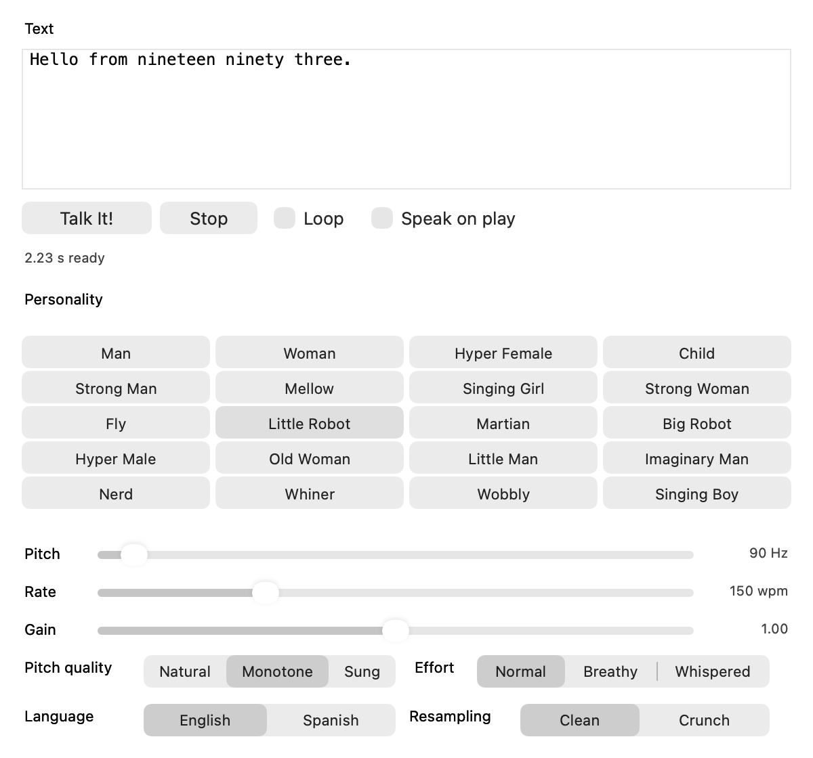

# TalkItVST

A CLAP / VST3 / AUv2 plugin built on the **TalkIt_OSS** reconstruction of the
SoftVoice engine that powered Microsoft **Talk It!** in 1993. Type text, pick
one of the original's 20 voices, hear it in your DAW.

This is a sibling of the other repos in the OpenTalkIt family and expects
`TalkIt_OSS` beside it, the same way `TiSpeech` does:

```
TalkIt_OSS/     the portable C engine and its speech data
TiSpeech/       .NET bindings            (not used here)
OpenTalkIt/     the Avalonia desktop app (not used here)
TalkItVST/      this repo
```

It links the engine's C library directly. None of the .NET side is involved:
`TiSpeech`, `TiSpeech.Client` and the x86 `TiSpeech.Host` play no part.

## Status

Phase 1, the **generator**: text and voice settings in, one rendered phrase
out, triggered by the transport or by any MIDI note. Phase 2 turns it into a
playable instrument — see [Next](#next).

What is built and tested:

| Piece | State |
|---|---|
| Engine wrapper, UTF-8 to Latin-1, 514-char chunking | done, tested |
| Lanczos-3 resampler, 11025 Hz to host rate | done, tested |
| Worker thread, lock-free hand-off to the audio thread | done, tested |
| `talkit-render` command line renderer | done |
| CLAP plugin: parameters, state, transport, note trigger | done, tested |
| VST3 and AUv2 bundles | built |
| Window: text, the 4x5 grid, every parameter | done, tested |
| Tested in a real DAW | **not yet** |



All three bundles build: `TalkIt.clap`, `TalkIt.vst3`, `TalkIt.component`.
`talkit-host` loads the `.clap` and exercises it as a host would — factory,
parameters, state round trip, note on, audio out — which covers the plugin
code all three formats embed. No DAW has loaded them yet, and Steinberg's own
VST3 validator could not be built here: it requires full Xcode, and this
machine has only the Command Line Tools.

The core builds and tests with no network access at all
(`-DTALKITVST_BUILD_PLUGIN=OFF`); the plugin targets fetch `clap` and
`clap-wrapper` from GitHub at configure time.

## Build

Needs CMake 3.24+, a C++20 compiler, and `TalkIt_OSS` checked out beside this
repo (or `-DTALKITVST_TISPEECH_DIR=/path/to/TalkIt_OSS`).

Core, command line tool and tests — no network:

```sh
cmake -S . -B build -G Ninja -DTALKITVST_BUILD_PLUGIN=OFF
cmake --build build
ctest --test-dir build -L talkit --output-on-failure
```

`-L talkit` matters: TalkIt_OSS registers its own tests into the same CTest
project, and we build its libraries but not its test binaries, so a bare
`ctest` reports those as not run.

Everything, including the plugin formats — fetches CLAP and clap-wrapper, and
through clap-wrapper the VST3 and AudioUnit SDKs:

```sh
cmake -S . -B build-plugin -G Ninja
cmake --build build-plugin
ctest --test-dir build-plugin -L talkit --output-on-failure
```

That leaves `TalkIt.clap`, `TalkIt.vst3` and `TalkIt.component` in
`build-plugin/`. Switch formats off individually with
`-DTALKITVST_BUILD_VST3=OFF` / `-DTALKITVST_BUILD_AUV2=OFF`.

Each format needs its own CMake target, which is not obvious from
clap-wrapper's API: `target_add_vst3_wrapper()` and
`target_add_auv2_wrapper()` call `target_sources()` on the target handed to
them, so they rewrite *that* target into their format. Pointing both at one
target makes the second silently clobber the first — which is why
`talkit_add_plugin_module()` exists.

### Checking the built plugin

```sh
./build-plugin/talkit-host build-plugin/TalkIt.clap
```

Loads the bundle, walks the factory, enumerates and labels every parameter,
round-trips the state (including rejecting state it did not write), creates
the window and parents it into a real `NSView`, clicks a personality button
and checks the edit arrives back as parameter events, sends a note on, and
checks real audio comes out of `process()`.

It also pauses between `process()` calls the way a host does. Synthesis
happens on a worker, so a host that spins `process()` flat out sees silence
simply because nothing has been rendered yet.

To look at the window without a DAW:

```sh
./build-plugin/talkit-host build-plugin/TalkIt.clap --window
./build-plugin/talkit-host build-plugin/TalkIt.clap --snapshot gui.png
```

`--window` opens the real plugin view in a standalone `NSWindow` (no audio
device, so nothing is heard, but everything else works). `--snapshot` renders
it offscreen to a PNG, which is where the picture above comes from.

## Command line renderer

`talkit-render` drives the same core the plugin uses, so anything heard here is
the core's behaviour rather than a host integration problem.

```sh
./build/talkit-render -t "Hello from nineteen ninety three." -o out.wav
./build/talkit-render --personality 9 --host-rate 48000 --crunch -o robot.wav
./build/talkit-render --list          # the 20 presets
./build/talkit-render --calibrate     # pitch value -> measured F0
```

## What the engine gives us, and what it costs

Measured on this machine (Apple silicon, release build):

- **Synthesis is 2000–8000x realtime.** A four-second phrase renders in 1.8 ms.
  Nothing about speech synthesis is a performance problem here, which is why
  the instrument phase can afford to pre-render every word at every semitone.
- **Resampling costs more than synthesis** — about 16 ms for four seconds of
  audio, because Lanczos-3 is evaluated per output sample. Still 250x realtime
  on a worker thread, but it is the part to optimise (a precomputed polyphase
  table) if it ever matters.
- **Output is 8-bit unsigned mono at 11025 Hz**, so the lo-fi character is in
  the source, not in our resampling. `Resampling: Clean` band-limits properly;
  `Crunch` is nearest-sample, i.e. the stair-step aliasing of naive playback,
  offered because people want it from a retro plugin.
- **514 Latin-1 characters per engine call**, asserted by `test_core` so a
  future engine build cannot change it silently. Longer text is split at
  sentence boundaries and the pieces are joined.
- **Synthesis allocates and is not streaming**, so it never runs on the audio
  thread. `RenderQueue` owns one worker; `process()` only ever reads a
  finished buffer.

### The engine's `pitch` is in hertz

Worth recording, because it was the open question for the instrument phase.
The restored presets hinted at it (Man 100, Woman 200, Child 350) and
`--calibrate` confirms it: with `Pitch Quality: Monotone`, a measured
fundamental tracks the `pitch` value one-for-one.

```
pitch   50    66    75    90   100   120   150   200   250   350
F0      50.1  66.0  75.0  90.4 100.2 119.8 151.0 204.2 256.4 355.6
```

Within half a percent to 150 Hz, within two percent to 400 Hz. Above that the
drift in the table is mostly the measurement: integer-lag autocorrelation at
11025 Hz cannot resolve a 800 Hz period to better than a few percent, so the
high end is unproven in either direction rather than known to be off.

The practical consequence: a MIDI note maps straight onto `pitch` with
`440 * 2^((note - 69) / 12)`. No calibration table, no formant-shifting
resampler.

## Layout

```
cmake/tispeech.cmake    Static facade over TalkIt_OSS (see the header comment)
src/core/
  Latin1.*              UTF-8 to Latin-1, transliterating real punctuation
  Voice.h               Engine ranges, enums, the original's 20 presets
  Engine.*              libtispeech wrapper: chunking, render, event rebasing
  Resampler.*           11025 Hz 8-bit to float at the host rate
  Utterance.h           A rendered phrase, immutable once published
  RenderQueue.*         The worker thread and the lock-free hand-off
  Player.h              Audio-thread playback
  Params.h              The parameter table, shared by plugin and tools
src/clap/Plugin.cpp     CLAP entry point; clap-wrapper makes VST3 and AUv2
src/clap/Gui.h          The window's interface to the plugin
src/clap/Gui.mm         The window itself, in AppKit
tools/talkit-render.cpp Command line renderer and the pitch calibration
tools/talkit-host.mm    Minimal CLAP host that verifies a built bundle
tests/test_core.cpp     45 checks over the whole core
```

### How the window and the host stay in step

Parameter edits have to travel both ways, and only one direction is obvious.

- **Window to host.** A CLAP plugin may only emit parameter events from
  `process()` or `params.flush()`, on the audio thread — but edits happen on
  the main thread, whenever someone drags a slider. `ParamRing` in
  `Plugin.cpp` is a single-producer single-consumer ring that carries them
  across with no lock and no allocation on either side; `request_flush()`
  covers the case where the transport is stopped and `process()` is never
  called. Without this the host would never learn what the window did.
- **Host to window.** A 20 Hz timer pulls current values back, so automation
  moves the controls. Polling rather than pushing keeps the audio thread from
  ever touching AppKit.
- **Presets fan out.** Choosing a personality moves pitch, rate, pitch quality
  and vocal effort too, and each one is reported separately — a host told only
  about the personality would go on automating the old pitch.
- **Text is debounced** by 350 ms. Committing per keystroke would re-render
  and mark the project dirty on every character.

### macOS build notes

Two things the build has to get right, both recorded in `CMakeLists.txt`:

- `CMAKE_OSX_DEPLOYMENT_TARGET` must be set to 11.0 **with `FORCE`**.
  `project()` has already created that cache entry empty, so a plain
  `set(... CACHE ...)` does nothing — and clap-wrapper dereferences the
  variable bare inside an `if()`, which is a hard CMake error when it is
  empty. 11.0 is also the oldest target the current SDK's libc++ supports;
  below it every clap-wrapper translation unit fails an availability warning
  that it compiles with `-Werror`.
- `OBJC` and `OBJCXX` must be enabled from the top level. clap-wrapper's macOS
  glue is Objective-C++ and it detects the compiler itself, but compile rules
  only exist for languages enabled at the top level, so otherwise the generate
  step fails on `CMAKE_OBJCXX_COMPILE_OBJECT`.

Two more things worth knowing when editing the plugin or the window:

- **clap-wrapper compiles our sources with its own `-Wall -Wextra -Wpedantic
  -Werror`** in the VST3 and AUv2 targets. Code that builds fine in the plain
  `.clap` can fail there — a GNU `?:` shorthand and one unused constant both
  did. Build all three targets before believing a change compiles.
- **Objective-C class names are global to the host process.** Two builds of
  this plugin loaded at once would collide on `TalkItVST_View`. The prefix
  makes that unlikely, not impossible; registering the classes at run time
  under a unique name is the real fix if it ever bites.

### Why a static engine, not the dylib

Upstream only exposes a shared `libtispeech` for P/Invoke, but every internal
piece is already a static library. `cmake/tispeech.cmake` compiles upstream's
own `src/capi.c` and links the same archives, so the plugin carries the engine
and its speech data inside its own binary — no rpath, no copying a dylib into
each bundle. The whole engine plus both languages adds about 2.7 MB.

## Next

Phase 2, the instrument:

1. **Pre-render bank.** On a text change, synthesize each word (or syllable,
   sliced with `TISPEECH_EVENT_SYLLABLE`) at every semitone in use, with
   `Monotone`. At 11 KB per second of audio, a 20-word phrase across 128 notes
   is about 11 MB — cheap enough to brute-force, which gives correct formants
   at every pitch instead of chipmunk resampling.
2. **Note to word.** A note-on speaks the next unit at that note's pitch.
   Decide the policy for a note shorter or longer than its word: truncate, let
   it ring, or compress with `rate`. This is the design question that decides
   whether the plugin feels musical.
3. **Load it in a DAW.** Everything so far is verified by `talkit-host`, which
   is thorough about the plugin API and says nothing about how a real host
   behaves.

## Licence and provenance

The plugin compiles in TalkIt_OSS's extracted SoftVoice speech data. See
`TalkIt_OSS/data/README.md` for where that data comes from and how it is
regenerated. Distributing a plugin puts more weight on that provenance than a
source release does; settle it before publishing binaries.

CLAP and clap-wrapper are MIT, which is why they were chosen over JUCE: no
GPL obligation and no commercial licence to track.
